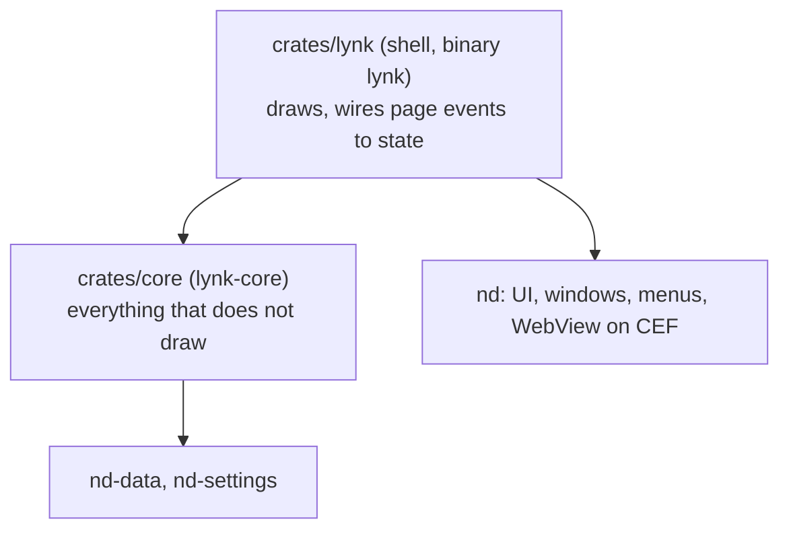

# Architecture

Read this first. It describes the Rust build as the code stands on `main`, not as it is meant to
end up. Where the code breaks one of its own rules, the section says so and names the audit item
(A1 to A13, listed at the end).

Lynk is an Arc-style Chromium browser. It is one Rust process on NativeDesktop (`nd`, source at
`~/Developer/ecosystem/nativedesktop`). `src/` is the old TypeScript app and serves only as the
spec until wave 4 deletes it. `PLAN.md` describes the WebKit era and nothing current.

## Layers



The arrows are the only allowed dependencies.

- **core never draws.** `crates/core/Cargo.toml` depends on `nd-data` and `nd-settings` and no
  other nd crate, so an nd UI import does not compile there. Core takes the platform as a value
  (`keys::chord(id, mac)`, `downloads::is_dangerous(name, mac)`) and has no `#[cfg]` on an OS.
- **The shell holds no logic core could test.** A rule about URLs, ordering, ranking, labels or
  file formats goes in core with a unit test, and the shell calls it. Shortfalls: A3 (a scheme
  check and a placement adapter in `window.rs`), A4 (tab reset logic spread over `page.rs`).
- **An nd gap is fixed in nd.** No workaround in the app. The fix is gated in nd, pushed, then
  repinned here with `cargo update -p nd` in a `chore(deps): nd <sha>` commit. nd's patched GPUI
  reaches this workspace only through `[patch.crates-io]` in the root `Cargo.toml`.

### What nd provides

| Need | nd |
| --- | --- |
| Elements, layout, theme, icons | `nd::prelude` (nd-ui on AppKit on macOS, on GPUI on Linux and Windows), `nd-theme`, `nd-icons` |
| Windows, split view sidebar, popovers, toasts, menus | `scaffold`, `sidebar`, `popover`, `toast_overlay`, `Menu`, `MenuItem`, `ContextMenu` |
| Actions and key bindings | `actions!`, `KeyBinding`, `cx.bind_keys`, key contexts |
| Pages | `nd::webview::WebView` and its events, on CEF in Chrome style (`nd-cef`), set in `crates/lynk/nativedesktop.toml` |
| Virtual list for the sidebar rows | `nd::virtual_list` |
| One instance per profile | `nd_ipc::instance` |
| Stored files and SQLite | `nd_settings::Store`, `nd_data::Database` |
| Automation and tests | `nd::test::TestApp` (unit), `nd-test` and `ndshell` (drive) |
| Bundle and manifest | `build.rs` calls `nd::build::app()`, `nd::manifest!()` reads `nativedesktop.toml` |

`examples/browser` in nd exercises every webview feature Lynk needs, one `BROWSER_SCENE` per
feature. It is the reference for how to call them.

### What Lynk owns

The tab and window model, the sidebar, the menus and chords, the app's own pages (new tab,
"Unable to load this page", "Aw, Snap!"), and every rule in core.

## Process and window model

One process. `lib::run` starts nd's `Application`. Inside its run callback `process::start` takes
the profile's instance lock through `nd_ipc` (endpoint `lynk`/`instance` in the app data dir). A
second launch hands its URLs to the holder and quits. The lock has to be taken inside the run:
nd-cef claims file descriptors 3 and 4 as the run starts, and Chromium itself starts with the
first page.

`process.rs` keeps a one-thread tokio runtime for two listeners: later launches, and SIGTERM
(console close on Windows). Each event hops to the main thread through `nd::system::spawn`.
SIGTERM quits like the Quit command, so Chromium flushes the profile. A launch opens its URLs as
tabs in the key window, or in a new window when none is open.

`app.rs` holds the `Browser` global: the window registry, the tab id counter (ids are unique
across windows, so a tab keeps its id when it moves), the closed-tab stack (25 addresses), the
zoom levels per host, and the last menu signature. Every window is an nd main window
`browser-<n>`, 1280 by 800, at least 720 by 480, with a custom title bar.

The menu bar is built from the key window (`app::key_window`). It is rebuilt when a window becomes
key and after every `BrowserWindow::changed`, and only set when its signature (labels and enabled
flags) differs. A window other than the first carries its own menu button in the sidebar foot.

When the last window closes, it stays in the registry with its tabs: the app is quitting, and that
window is what a relaunch will restore.

## Tab and page lifecycle

A `Tab` (`tab.rs`) is an address, a title, a `Page` and `rt`, the last facts its page reported.
`Page` is `Waiting` (no page yet), `Live` (the `WebView`) or `Asleep { scroll }`, so a sleeping
tab with a page or a scroll to restore on a live one cannot be written. The page is Chromium's. `rt` is only a cache of what it said.

```mermaid
stateDiagram-v2
    [*] --> Waiting: Tab::new (restored, background, launch)
    [*] --> Live: Tab::with_page (a popup the page opened)
    Waiting --> Live: shown (BrowserWindow::show calls wake)
    Live --> Asleep: Put Tab to Sleep (scroll read, page dropped)
    Asleep --> Live: shown again (scroll put back once loaded)
    Live --> Closing: close_tab asks the page (beforeunload)
    Closing --> Live: page refuses
    Closing --> [*]: page agrees (close_answered, remove)
    Waiting --> [*]: close_tab, nothing to ask
    Asleep --> [*]: close_tab, nothing to ask
```

- **Lazy pages.** A tab gets its `WebView` the first time it is shown. A tab with an empty address
  is the new tab page and never gets one; `page::cover` draws it.
- **Mounting.** Every live page stays mounted so it keeps reporting: the shown one fills the
  content area, the rest sit in a zero-size holder (`shell.rs`, `content`). Mounting a page
  elsewhere moves it without a reload, which is how a tab moves to another window with its page.
- **Navigation.** `Tab::navigate` loads in the existing page, except for the schemes Chromium
  will not walk to (`tabstate::create_at_url`), which get a fresh page. A Chromium page the app
  replaces (`pages::native_page`: downloads, history, bookmarks, tab search, new tab) is undone
  and the app's own command is dispatched instead.
- **Sleep.** `BrowserWindow::sleep` reads the scroll position with a 500 ms limit, drops the page,
  and keeps the row, title, icon and address. If the sleeping tab was shown, the nearest awake tab
  takes over.
- **Close.** Every close that waits on a page's `beforeunload` is held in one place,
  `BrowserWindow::closing`: the window's own close, the tabs to close, and the pages asked (each
  with the `WebView` asked, so an answer from a page since replaced is stale). `settle` is the only
  code that carries a close out, and `changed()` runs it after every change to the window's tabs
  or pages, so a new path that drops, replaces or moves a page settles by calling `changed()` as
  it already must. nd answers for a page that hangs or has no document after `BEFOREUNLOAD_WAIT`,
  so the shell keeps no timer of its own. `remove` puts the address on the closed stack and fires
  `TabEvent::Closed`; the last tab takes its window with it. A window that is closing, or whose
  every tab is, takes no launch (`pending_close`).

  | Event | Path | The pending close |
  | --- | --- | --- |
  | Tab close asked | `close_tab(id)` | `id` joins `tabs` and its page is asked once; the same id again does nothing; a tab with no page or a crashed one goes at once |
  | Close Tab pressed | `close_shown` (key, menu bar, page command) | the shown tab, or while it waits the next tab not already closing |
  | Window close asked | `should_close` | `window` is set and every page not already asked is asked; with nothing to ask the window goes at once |
  | Approved | `close_answered(id, page, true)` | the page leaves `asked`; `settle` removes its tab if that tab's close was asked, and closes the window once nothing is asked |
  | Cancelled | `close_answered(id, page, false)` | the page leaves `asked`, its tab leaves `tabs`, `window` is cleared; other tabs' closes go on |
  | Timed out | nd | arrives as an approval |
  | Page slept | `sleep` | refused while the page is asked or the window is closing |
  | Page replaced or crashed | `navigate`, a native page in `page.rs`, a renderer gone | `settle` drops the stale ask; a tab close then goes ahead, a window close stops waiting on it |
  | Replaced page answers late | `close_answered` with the old page | ignored: an answer counts only from the page that was asked, and each page mounts under its own element key (`Live::key`), so nd never routes the old page's events to its successor |
  | Page closed itself | `remove` (`WindowClosed`) | the tab and its ask go |
  | Tab moved out | `take` | refused while the tab is closing or its page is asked |
  | Tab moved in | `move_tab` | refused into a window that is closing or whose every tab is |

- **Errors.** A failed load sets `rt.error` and a dead renderer sets `rt.crashed`; `page::cover`
  draws "Unable to load this page" or "Aw, Snap!" over the page with a retry button.

## Registries

Later features plug in by appending to a list the shell owns. Each list is a `const` slice of
plain function pointers, read in order. Registration happens at compile time, so there is nothing
to register at runtime and no trait object. A lane adds its function in its own module and one
line to the slice; that one line is the only edit in a file another lane owns.

Ids and key contexts below are the existing ones; copy the shape of the nearest sibling.

### `actions::COMMANDS`

Every command the menu bar, the keyboard and later the command bar share. A row names the action,
label, chord id, menu, enable probe and handler. The menu bar is built from the rows in table
order, so a menu item always shows its chord. A Chrome-style page passes a chord to the main menu
before taking it itself, so a chord that must work over a page has to be a menu item.

To add a command:
1. Add the action to the `actions!` list in `actions.rs` (or a struct action beside `SelectTab`).
2. If it has a chord, add its id and spelling to `lynk_core::keys`. The test
   `every_core_chord_has_a_command` fails until a row uses it.
3. Write the handler in your module, `fn(&mut BrowserWindow, &mut Window, &mut Context<BrowserWindow>)`.
4. Add the row at the position its menu item takes:
   `Command::new::<A>("Label").key("id").menu(MenuId::View).enabled(probe).handler(module::handler)`.
   A row that already exists with no handler is a placeholder for your feature: give it the
   handler, do not add a second row.
5. If Chromium has a command for it, map it in `page::chrome_command`.

### `actions::MENU_ITEMS`

Menu items that are not commands, appended after a menu's commands, as
`(MenuId, fn(&BrowserWindow, &App) -> Vec<MenuItem>)`. The Tabs menu's tab list is the one entry.
To add: write the function in your module, append the pair.

### `actions::CONTEXT_KEYS`

Keys bound only inside one part of the window, under that part's key context (Esc in the find
bar). To add: define a context name in your module, put `.key_context(NAME)` on your element,
export `fn your_key() -> KeyBinding`, append it.

### `sidebar::FOOT`

The sidebar foot's slots, leading to trailing, each `fn(&BrowserWindow, &mut Window, &mut
Context<BrowserWindow>) -> Option<AnyElement>`. `None` hides the slot. The intended order is in
the doc comment on `FOOT`: settings, padlock, zoom, blocked pop-ups, the window menu, extensions,
downloads. To add: write the slot in your module, insert it at its place in that order. A slot
with a popover follows `zoom::glyph`: an anchor `div` with the button, and the popover as its
child while open, placed `Trailing`.

### `site_info::ROWS`

Rows of the padlock popover under the security sentence, each
`fn(&BrowserWindow, &Tab, &mut Window, &mut Context<BrowserWindow>) -> Option<AnyElement>`. The
intended order: the ad blocking switch with its count, then the site's permissions. To add: write
the row, append it.

### `page::OBSERVERS`

Hear every page event of every tab, after the window has taken it in, as
`fn(&mut BrowserWindow, TabId, &PageEvent, &mut Window, &mut Context<BrowserWindow>)`. To add:
write the observer, append it, keep its state in your own global keyed by `TabId` (see State).
If you need an nd webview event that `PageEvent` lacks, add the variant and its listener in
`page::mount`; that is a change to the shell lane's file, so coordinate it.

### `window::TAB_EVENTS`

Hear `Opened`, `Closed`, `Moved` (taken out to another window) and `Shown` for every tab of every
window, after the window's own change, as `fn(&mut BrowserWindow, TabId, TabEvent, &mut
Context<BrowserWindow>)`. To add: append to the list. Unit tests run the same listeners and also
record each event.

### `window::WINDOW_CLOSED`

Called as a window goes, as `fn(&mut App, WindowId)`, so a feature drops what its global keeps for
that window. A feature with per-window state appends its `forget` here.

### `shell::OVERLAYS`

Layers drawn over the whole window above the page, back to front, each
`fn(&BrowserWindow, &mut Window, &mut Context<BrowserWindow>) -> Option<AnyElement>`. The command
bar and the panels go here. A full-size layer takes every click, so return `None` while closed.

### The command bar

`omnibox.rs` is one entry in `OVERLAYS`: nd's `command_palette`, mounted only while the window
has a bar open, so a closed bar takes no clicks. Its state is one `Bar` per window (mode, where
Return sends an address, the typed query) in the module's own global. `NewTab`, `OpenAddress`
and `OpenSwitcher` in `COMMANDS` open it; Cmd+T makes no tab until Return, so a bar put away
leaves none. Each render asks `lynk_core::omnibox::omni_rows` for the rows and drops command rows
whose `COMMANDS` row has no handler or is disabled; a row's id names what Return does (`url`,
`go:`, `hist:`, `tab:`, `cmd:`). Typed text becomes an address through `lynk_core::url::to_url`
with the engine from `cx.settings::<LynkSettings>()`. Highlight, inline completion and the keys
are nd's `PaletteModel`; the shell feeds back every reported query, which the model tells apart
from a reseed even when the echo trails the typing.

### `BrowserWindow::open_tab`

The one way to open a tab in a window: `open_tab(url, Open, cx) -> TabId`, empty `url` for the new
tab page. `Open::End`, `Open::At { index, foreground }`, or `Open::FromPage { opener, foreground }`
for Chrome's placement of a tab a page asked for. A tab built around an existing page goes through
`BrowserWindow::insert`.

### `app::open_window`

The one way to open a window: `open_window(cx, tabs, active) -> WindowId`. No tabs gives one new
tab page. A tab moved out of another window goes through `app::open_window_around`, which skips
`TabEvent::Opened` because `Moved` already fired.

## State

| State | Owner | Who may mutate | How it reaches the UI |
| --- | --- | --- | --- |
| Windows, tab ids, closed stack, zoom per host, menu signature | `app::Browser` global | functions in `app.rs` | menus through `refresh_menus*`; zoom through `apply_zoom_everywhere` |
| Tabs of a window, their order, the shown tab, fullscreen, closing | `BrowserWindow` (`window.rs`): `tabs` unordered, order and pins in core's `SidebarTree` | methods on `BrowserWindow` | `changed()`: sidebar rows, `cx.notify()`, menu bar |
| A tab's address, title, page, last reported facts, find query | `Tab` (`tab.rs`) | `BrowserWindow` methods and the page listeners in `page.rs` | through the window's `changed()` or `cx.notify()` |
| Page content, history, scroll | Chromium | Chromium | page events into `Tab::rt` |
| A feature's own per-tab or per-window data (zoom and site info popovers, the hovered row) | the feature's global, keyed by `WindowId` or `TabId` | the feature module | `cx.notify()` on the window entity |

Use `changed()` when a change can move a menu item or a sidebar row. Use `cx.notify()` alone when
it cannot (load progress, find counts).

Shortfall: `window.rs` says every tab change goes through its methods, but `page.rs`, `find.rs`,
`zoom.rs`, `site_info.rs` and `sidebar.rs` write `BrowserWindow` and `Tab` fields directly, and
per-feature view state now lives in each feature's global (A2, partly resolved).

The shell holds a window's tab order in core's `SidebarTree` and keeps its own `u64` `TabId`s,
converting at the boundary with `session::tab_id` and `tab_number`. Placement of opened tabs is
core's `place_opened_tab` on that tree, and the next tab after a close is core's
`spaces::neighbour`. Spaces, folders and persistence are not wired, so the tree has only pins and
root tabs.

## Persistence

The shell persists nothing yet. The only thing on disk is the Chromium profile and the instance
lock, both in nd's app data dir. Core has every store ready; the wave 2 lanes wire them.

| File (0.5.11 layout, read unchanged) | Core module | Format |
| --- | --- | --- |
| `settings.json` | `settings` (`LynkSettings`, `#[derive(Settings)]`) | `nd_settings`; `from_legacy` reads the 0.5.11 file |
| `session.json` | `session` | `nd_settings::Store`, version 3 |
| `history.sqlite` | `history` | `nd_data`, table `visits(id, url, title, ts)` |
| `bookmarks.json`, `downloads.json` | `bookmarks`, `downloads` | `nd_settings::Store` |
| `blocking.json`, `adblock/` | `adblock`, `ublock` | `Store`, plus uBO release files and a cached engine |
| `favicons/light/`, `favicons/dark/` | `favicons` | one `data:` URL per origin |

Session versions: 1 is the 0.5.11 single-window file, 2 has a flat tab list per window, 3 adds
spaces and one sidebar tree per space. `session::open` migrates through the store's `migrate`
hook. The caller must run `session::normalize` on what it reads (A10). To add a version: bump
`SESSION_VERSION`, add a `from < N` step to `migrate`, and add a test that reads a version N-1
file. Every stored struct reads `null` and wrongly shaped entries as defaults (`null_default`,
`lenient_items` in `core/src/lib.rs`), so a hand-edited file keeps what it can.

Zoom levels live in memory in `app::Browser` until session restore lands; `SessionState` has the
field for them. Session tab ids are strings (`t1`), shell tab ids are `u64`; `tab_id` and
`tab_number` convert.

Blocking: the pinned uBO release (`ublock::PINNED_VERSION`, checked by SHA-256) is the source of
lists, scriptlets and redirect resources; a newer release is picked up weekly. Nothing calls
`ublock::scriptlet_resources` yet; the `blocking-tools` lane wires it.

## Platforms

| Kind of difference | Where it lives | Example |
| --- | --- | --- |
| How the OS behaves: windows, input, drawing, webview hosting | nd | Chrome-style pages as a child `NSView` on macOS, an X11 child under XWayland on Linux (`nd-cef`) |
| An idiom Lynk chooses per OS | the shell module that draws it, through `nd::platform::target()` | the New Tab row on macOS and Windows, the plus in the foot on Linux (`sidebar.rs`) |
| Data that differs per OS | core, as a parameter | chords (`keys::chord(id, mac)`), dangerous file types |
| An API that exists on one OS only | `#[cfg]` in the shell | `process::terminations` (SIGTERM on unix, console close on Windows) |

Rule for a new difference: pick the first row that fits. Add `#[cfg]` only when the code would not
compile on the other OS. Shortfall: three local `mac()` and `linux()` helpers (A13).

State per OS: macOS is the reference and the drive runs there. Linux runs pages in Chrome style
under XWayland. On Windows nothing in nd's CEF engine has run yet.

## Tests and gates

| Rung | Command | Proves |
| --- | --- | --- |
| Core unit | `env -u SDKROOT -u DEVELOPER_DIR CARGO_TARGET_DIR=target/core cargo test -p lynk-core`, then `cargo clippy -p lynk-core --all-targets -- -D warnings` | every rule in core, without a window or Chromium |
| Shell unit | `cargo test -p lynk --lib` (with the drive's `CEF_PATH` and `env -u`) | window and tab bookkeeping on `nd::test::TestApp`: tab events, menu building, labels |
| Drive (macOS) | `env -u SDKROOT -u DEVELOPER_DIR CEF_PATH="/Volumes/Kyan Drive/dev-cache.noindex/cef" ND_REAL=1 cargo test -p lynk --test shell_drive -- --test-threads=1` | the real app in Chrome style with the real pointer, one named case per checklist box; captures in `target/tmp/shell-*.png` |
| linux-gate | `scripts/linux-gate sync`, then `scripts/linux-gate drive 3` | the drive in headless Hyprland on g815 |
| windows-vm | `scripts/windows-vm up`, `sync`, `run '<powershell>'`, `shot <png>` | the app in the Windows 11 guest on g815 |

The drive opens real windows and moves the real pointer, so only one runs at a time on the macbook.
It is `#[cfg(target_os = "macos")]` until the Linux gate drives it. `scripts/linux-gate` and
`scripts/windows-vm` arrive with the Linux and Windows lanes; until then use nd's own
`scripts/linux-gate` and, for a Windows compile check, `cargo xwin clippy --target
x86_64-pc-windows-msvc -p lynk` with LLVM's `llvm-rc` on `PATH`. A box in `docs/nd-parity.md` is
ticked in the same commit as the case that proves it, and the line names the case.

## Module map

Shell, `crates/lynk/src`:

| Module | Owns | Must not |
| --- | --- | --- |
| `lib.rs` | `run` and `init`: the first window | hold state |
| `process.rs` | instance lock, later launches, SIGTERM | touch a window's tabs except through `open_tab` and `open_window` |
| `app.rs` | the `Browser` global, window open and close, menu bar refresh | draw |
| `window.rs` | one window's tabs and their lifecycle, `TAB_EVENTS` | draw, or know a feature's internals |
| `tab.rs` | one tab and its page's lifetime | reach the window |
| `page.rs` | page events into window state, `OBSERVERS`, the app's own pages | keep feature state |
| `shell.rs` | the window as drawn, `OVERLAYS`, handlers for the shell's own commands | hold tab rules |
| `sidebar.rs` | the controls row, tab rows and their menus, `FOOT` | own tab order |
| `actions.rs` | actions, `COMMANDS`, `MENU_ITEMS`, `CONTEXT_KEYS`, bindings, menu bar | run a command's logic |
| `find.rs` | find in page | touch another tab |
| `omnibox.rs` | the command bar: its state per window, running the picked row | rank rows or parse typed text (core does) |
| `zoom.rs` | zoom steps, the foot glyph and popover | store levels outside `app` |
| `site_info.rs` | the padlock and its popover, `ROWS` | decide a security verdict (core does) |
| `main.rs` | calls `lynk::run` | anything else |

Core, `crates/core/src`:

| Module | Owns | Must not |
| --- | --- | --- |
| `lib.rs` | `now_ms`, lenient serde helpers | grow a utility grab bag |
| `url` | address field text, host, display address | do I/O |
| `keys` | every chord in menu spelling | know nd's binding spelling |
| `settings` | `LynkSettings`, reading the 0.5.11 file | hold runtime state |
| `session` | `session.json`, migration, normalize, Chrome's tab placement | draw |
| `sidebar_tree` | one space's pins and rows: tabs, separators, folders, splits | know about pages |
| `spaces` | spaces, link rules, a window's sidebars per space | know about pages |
| `tidy` | grouping loose tabs under separators, with undo | call a model itself |
| `tabstate` | padlock verdict, find summary, tab labels | hold a tab |
| `pages` | which `chrome://` pages the app replaces | dispatch anything |
| `omnibox` | command bar rows and ranking, inline completion | send typed text anywhere |
| `history` | `history.sqlite` | block the main thread (it is async) |
| `bookmarks` | `bookmarks.json` | nest |
| `downloads` | `downloads.json`, file names, status lines | run a transfer |
| `favicons` | the icon cache per origin and appearance | decode for drawing |
| `permissions` | prompt sentences, decisions per origin | answer a prompt |
| `zoom` | Chromium's zoom steps, levels per host | set a page's zoom |
| `extensions` | extension rows, pins, popup bounds | talk to Chromium |
| `webstore` | the store fixup and install hold scripts, permission lines | install |
| `adblock` | `blocking.json`, the engine build and cache | hold the engine across a network call |
| `ublock` | uBO release pinning, lists, scriptlets, resources | write `blocking.json` |

## Rules for new code

- Smallest complete change. Before writing, check that it needs to exist and that it is not
  already here, in nd, in std or in an installed dependency. No wrapper, option, config knob,
  single-implementor trait, conversion layer or code "for later". Finish every caller, test and
  fixture in the same change.
- One module owns one feature and its state. Talk to other modules through the registries above
  and small typed functions, never by writing their fields.
- A rule that can be tested without a window goes in core with a test.
- Validate at the boundary (a file read, a page event, a typed address), then trust the type. Make
  an illegal state unrepresentable where a type can.
- Each module opens with a `//!` saying what it owns and what it must not do.
- A known shortcut carries `shortcut: <the limit>, <when to upgrade>`.
- Comments state only what the code cannot: a Chromium quirk, an ordering requirement, a value
  that looks wrong.

## Audit

Ranked findings from 2026-11-24 against `main` at `839861b`. Line numbers are the committed state.

- **A1** Resolved. `crates/lynk/src/tab.rs:62`: `page: Option<WebView>`, `asleep`, `scroll` and `rt.closing`
  allow states that cannot happen (asleep with a page, a scroll to restore on a live page). One
  `enum Page { Waiting, Live(WebView), Asleep { scroll } }` rules them out.
- **A2** `crates/lynk/src/page.rs:128`, `zoom.rs:36`, `site_info.rs:37`: modules write
  `BrowserWindow` and `Tab` fields directly, and feature view state lives on `BrowserWindow`.
- **A3** Resolved. `crates/lynk/src/window.rs:208`: `placement` builds fake `SessionTab`s with stringified
  ids to call `place_opened_tab`; `window.rs:161` checks URL schemes in the shell.
- **A4** `crates/lynk/src/page.rs:207`: undoing a native page resets the tab field by field,
  beside `Tab::sleep` and `Tab::navigate`, which reset the same fields their own way.
- **A5** `crates/lynk/src/sidebar.rs:55`: the window menu repeats labels and enable rules that
  `COMMANDS` already holds.
- **A6** `crates/lynk/src/actions.rs:88`: `RowCommand` with `ForTab` is a second dispatch path
  beside `COMMANDS` for the same operations on a given tab.
- **A7** `crates/lynk/src/shell.rs:131`: fourteen handlers that only call a `BrowserWindow` method
  on the shown tab.
- **A8** `crates/core/src/omnibox.rs:166`: "host without `www.`" is written five times in core,
  and `origin_of` twice.
- **A9** `crates/core/src/tidy.rs:28`: `TabGrouper` has no implementor outside a test.
- **A10** `crates/core/src/session.rs:197`: callers must remember to `normalize` after `open`.
- **A11** Resolved. `crates/core/src/tabstate.rs:21`: `Security::icon` returns GTK icon names nothing
  reads; `site_info::icon_of` is the live mapping.
- **A12** Resolved. `crates/lynk/src/window.rs:48`: `TAB_EVENTS` has a test twin, so listeners lanes add
  never run in unit tests.
- **A13** `crates/lynk/src/sidebar.rs:265`, `actions.rs:341`: local platform helpers repeated.
